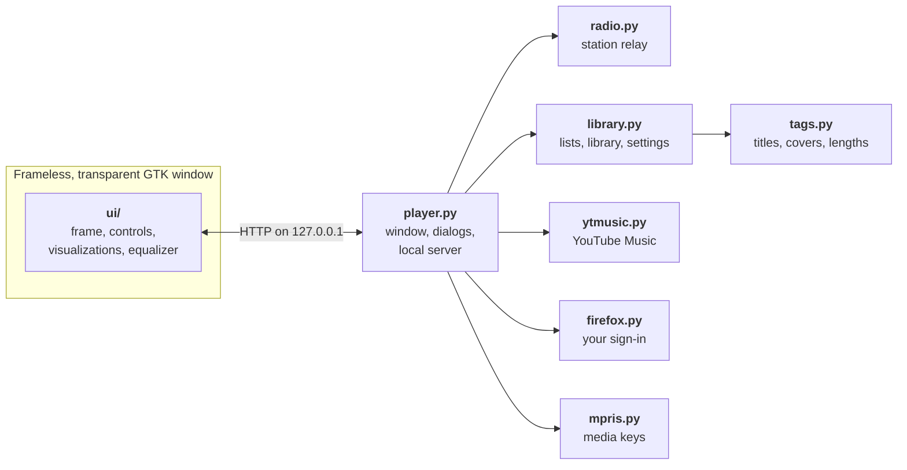
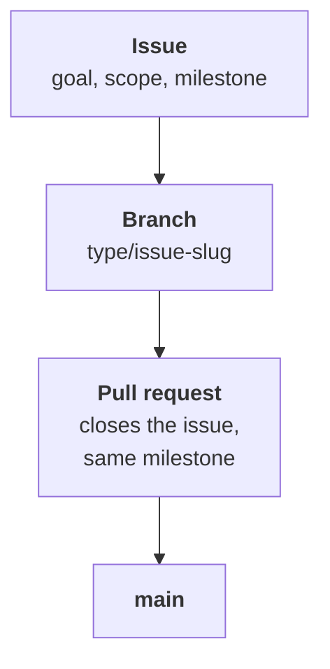

<div align="center">
  
  <h1>Ocean Mist</h1>
  <p><strong>The media player of the early 2000s, playing your music on Linux today.</strong></p>
  <p>
    A tribute to the look of Windows Media Player 9, drawn again from scratch:<br>
    the sculpted frame, the green status line, and visualizations you can watch for a whole album.
  </p>
  <p>
    
    
    
    
    <a href="LICENSE"></a>
  </p>
  <p>
    <a href="#a-look-around">A look around</a> &nbsp;·&nbsp;
    <a href="#what-it-does">What it does</a> &nbsp;·&nbsp;
    <a href="#get-started">Get started</a> &nbsp;·&nbsp;
    <a href="#keyboard">Keyboard</a> &nbsp;·&nbsp;
    <a href="#how-it-works">How it works</a> &nbsp;·&nbsp;
    <a href="#roadmap">Roadmap</a>
  </p>
</div>

<p align="center">
  
</p>

<p align="center">
  <sub>Every picture on this page is the player itself. The music in them is generated sample audio with invented names.</sub>
</p>

> [!NOTE]
> Ocean Mist is an unofficial fan project. It is not affiliated with, endorsed by or connected to Microsoft. Windows, Windows Media and the Windows logo are trademarks of Microsoft.

## A look around

### Visualizations that move with the music

<table>
  <tr>
    <td width="25%"></td>
    <td width="25%"></td>
    <td width="25%"></td>
    <td width="25%"></td>
  </tr>
  <tr>
    <td align="center"><sub>Battery : Kaleidovision</sub></td>
    <td align="center"><sub>Battery : Event Horizon</sub></td>
    <td align="center"><sub>Bars and Waves : Bars</sub></td>
    <td align="center"><sub>Ambience : Water</sub></td>
  </tr>
</table>

### The rest of the player

<table>
  <tr>
    <td width="50%"></td>
    <td width="50%"></td>
  </tr>
  <tr>
    <td valign="top"><strong>Graphic equalizer.</strong> Ten bands, eleven presets, and it remembers your own curve.</td>
    <td valign="top"><strong>Media Library.</strong> Your music folder by artist, album or genre, with search, sorting and your saved playlists.</td>
  </tr>
  <tr>
    <td></td>
    <td></td>
  </tr>
  <tr>
    <td valign="top"><strong>Radio Tuner.</strong> Internet radio stations, with the song title in the status line when the station sends it.</td>
    <td valign="top"><strong>Your color.</strong> The original blue, or purple, pink, red, orange, green or teal.</td>
  </tr>
</table>

### Compact mode

When the music matters more than the window, the player shrinks to a small bar that stays out of the way.

<p align="center">
  
</p>

## What it does

<table>
  <tr>
    <td width="170" valign="top"><strong>Visualizations</strong></td>
    <td>Eight of them: Battery (Randomization, Kaleidovision, Spider's Last Moment, Event Horizon, Sepiaswirl), Bars and Waves (Bars, Scope) and Ambience (Water). Or show the album cover instead.</td>
  </tr>
  <tr>
    <td width="170" valign="top"><strong>Graphic equalizer</strong></td>
    <td>10 bands from 31 Hz to 16 kHz, ±12 dB each, with 11 presets such as Rock, Jazz and Bass boost.</td>
  </tr>
  <tr>
    <td width="170" valign="top"><strong>Media Library</strong></td>
    <td>Reads your Music folder, and any other folder you add. Browse by artist, album or genre, search as you type, sort by any column. The files stay where they are.</td>
  </tr>
  <tr>
    <td width="170" valign="top"><strong>Now Playing list</strong></td>
    <td>Two lists, one player: My Music for your files and YouTube Music for what you play from Premium Services, kept apart and switched at the list's top right. Drag songs to reorder them, queue a song to play next, shuffle, repeat the list or a single song. Open a song from your file manager and its folder comes along as My Music.</td>
  </tr>
  <tr>
    <td width="170" valign="top"><strong>Playlists</strong></td>
    <td>Opens and saves <code>.m3u</code>; also reads <code>.m3u8</code> and <code>.pls</code>.</td>
  </tr>
  <tr>
    <td width="170" valign="top"><strong>Radio Tuner</strong></td>
    <td>Plays internet radio stations from a stream address or a <code>.pls</code> / <code>.m3u</code> link, and shows the song title when the station sends one. Add your own stations by address.</td>
  </tr>
  <tr>
    <td width="170" valign="top"><strong>YouTube Music</strong></td>
    <td>In Premium Services: search for songs, albums, artists and playlists, open them with their covers, and play them in a YouTube Music list of their own, with the equalizer and the visualizations. When the list runs out, similar songs carry on (<em>Autoplay similar songs</em> in the menu turns that off). The list lives in memory only and starts empty each time; save it as a playlist to keep it. Nothing else to install, and no account needed: sign in through Firefox to bring in your playlists and Liked music, like songs and add them to your playlists (see <em>Signing in to YouTube Music</em> below).</td>
  </tr>
  <tr>
    <td width="170" valign="top"><strong>Formats</strong></td>
    <td>MP3, FLAC, Ogg Vorbis, Opus, M4A/AAC and WAV. Titles, covers and lengths are read by the player itself.</td>
  </tr>
  <tr>
    <td width="170" valign="top"><strong>Desktop integration</strong></td>
    <td>Implements MPRIS, the interface behind your keyboard's media keys and the desktop's media controls. Optional notification when the song changes.</td>
  </tr>
  <tr>
    <td width="170" valign="top"><strong>Sizes</strong></td>
    <td>Compact mode, full screen, and five player sizes from 100% to 200% for high-resolution screens.</td>
  </tr>
  <tr>
    <td width="170" valign="top"><strong>Small comforts</strong></td>
    <td>Picks up where you left off in your files or on the radio. A sleep timer stops the music after a set time or at the end of the song.</td>
  </tr>
</table>

> [!NOTE]
> YouTube Music support is unofficial. Ocean Mist is not affiliated with or endorsed by Google or YouTube, and it talks to YouTube Music the way the website does rather than through a published API, so a change on their side can break it until the player is updated. YouTube's terms of service apply to what you play. YouTube and YouTube Music are trademarks of Google LLC.

## Get started

Ocean Mist has no build step and nothing to compile: it is a handful of Python files and a web page.

**1. Install what it needs.** On Ubuntu or Debian:

```sh
sudo apt install python3-gi gir1.2-gtk-3.0 gir1.2-webkit2-4.1 \
  gstreamer1.0-plugins-good gstreamer1.0-plugins-bad gstreamer1.0-libav
```

On other distributions, install the equivalents: Python 3 with PyGObject, GTK 3, WebKitGTK with the 4.1 API, and the GStreamer plugins for the formats you listen to.

**2. Get it and run it.**

```sh
git clone https://github.com/NahuelGenchi/ocean-mist.git
cd ocean-mist
python3 player.py
```

Give it a song, a folder or a playlist to start playing right away:

```sh
python3 player.py ~/Music/album/song.flac
```

**3. Add it to your app menu** (optional). Run this from inside the `ocean-mist` folder:

```sh
mkdir -p ~/.local/share/applications
sed "s|@OCEAN_MIST_DIR@|$PWD|" data/io.github.nahuelgenchi.OceanMist.desktop.in \
  > ~/.local/share/applications/io.github.nahuelgenchi.OceanMist.desktop
install -Dm644 data/io.github.nahuelgenchi.OceanMist.svg \
  ~/.local/share/icons/hicolor/scalable/apps/io.github.nahuelgenchi.OceanMist.svg
```

After that, Ocean Mist appears in the app menu and in the "Open with" list for music files.

<details>
<summary><strong>Where it keeps things</strong></summary>

<br>

| What | Where |
| :--- | :--- |
| Settings, My Music, stations, where you left off | `~/.config/ocean-mist/state.json` |
| Tag cache and your files' covers | `~/.cache/ocean-mist/` |

Nothing from YouTube Music is kept there, or anywhere else on disk unless you save a playlist: its list, searches and covers stay in memory, and so does your library when you sign in. The page keeps no web cache or site data. The covers it hands to the desktop's media controls wait in the runtime folder (`$XDG_RUNTIME_DIR`, which lives in memory) until the player closes. Of a sign-in, `state.json` only notes which Firefox profile you chose.

Your music files are only ever read, never changed. Developed on Ubuntu 26.04 with GNOME on Wayland and Python 3.14; other setups have not been tried yet.

</details>

<details>
<summary><strong>Signing in to YouTube Music</strong></summary>

<br>

Ocean Mist has no sign-in form of its own and never sees your password. You sign in to YouTube Music in Firefox, on Google's own page, and Ocean Mist uses that sign-in:

1. In Premium Services, choose **Library**, then **Sign in with Firefox**.
2. If Firefox is signed in to YouTube already, that is all. If not, Firefox opens on YouTube Music's sign-in page: sign in there, and Ocean Mist carries on by itself.
3. If more than one of your Firefox profiles is signed in to YouTube, choose the one Ocean Mist should use. They are listed by the names Firefox's profile menu shows, and Ocean Mist keeps to the one you chose.

Your playlists and Liked music then show under Library, and play like any playlist. Right-click a song to like it, to take the like back or to add it to one of your playlists. In a playlist of your own, you can also take a song out.

What Ocean Mist reads, and when:

- It reads the sign-in only while you are signed in (or signing in), and only when it asks for something of your account: your library, a playlist of yours, a like, a change to a playlist.
- It reads it from the cookie file of the Firefox profile you chose, read-only and straight into memory: no copy goes to disk, and the file is never written to. It takes only the YouTube cookies, not those of containers, and lets them go once the request is made. While you sign in, it reads every profile's cookie file this way, to see which ones are signed in. It also reads the profiles' names, to tell them apart.
- It never asks Google for your name, email address or photo. Your library, likes and playlists stay in memory, like the YouTube Music list. The only thing remembered is which Firefox profile you chose.
- Searches, albums, artists, similar songs and the music itself are still asked for anonymously, so they do not show in your YouTube history.

**Sign out**, at the top of Library, only stops Ocean Mist from using the sign-in: Firefox stays signed in. To sign out of YouTube itself, do it in Firefox. If you sign out there, or clear Firefox's cookies, Ocean Mist is signed out too.

Ocean Mist looks for your Firefox profiles where Firefox from Mozilla or from your distribution, the Snap and the Flatpak keep them, and signing in needs Python 3.11 or newer. Other browsers are not supported. If several Google accounts are signed in at once in that profile, the first one is used.

> [!CAUTION]
> These are YouTube Music's own web requests, not a published API, and signed in they are tied to your account. YouTube could sign the session out, or restrict the account. Ocean Mist makes them only for what you ask, at a person's pace.

</details>

## Keyboard

| Keys | Action |
| :--- | :--- |
| <kbd>Space</kbd> or <kbd>Ctrl</kbd>+<kbd>P</kbd> | Play or pause |
| <kbd>Ctrl</kbd>+<kbd>S</kbd> | Stop |
| <kbd>Ctrl</kbd>+<kbd>B</kbd> / <kbd>Ctrl</kbd>+<kbd>F</kbd> | Previous / next song |
| <kbd>←</kbd> / <kbd>→</kbd> | Back / forward 5 seconds |
| <kbd>↑</kbd> / <kbd>↓</kbd> | Volume up / down |
| <kbd>Ctrl</kbd>+<kbd>H</kbd> | Shuffle on or off |
| <kbd>Ctrl</kbd>+<kbd>T</kbd> | Repeat: off, list, song |
| <kbd>Ctrl</kbd>+<kbd>O</kbd> | Open files |
| <kbd>Ctrl</kbd>+<kbd>2</kbd> / <kbd>Ctrl</kbd>+<kbd>1</kbd> | Compact mode / back to the full player |
| <kbd>F11</kbd> or <kbd>Alt</kbd>+<kbd>Enter</kbd> | Full screen (<kbd>Esc</kbd> leaves it) |
| <kbd>Enter</kbd> / <kbd>Delete</kbd> | Play / remove the selected song in the list |

The keyboard's media keys reach the player through the desktop's media controls (MPRIS).

## How it works

The window has no title bar and no borders of its own: it is a transparent, frameless GTK window showing a local web page, and the page draws the whole player: the frame in SVG, the visualizations on a canvas. `player.py` owns the window and runs a small server on `127.0.0.1` that hands the page its files, your songs, the radio streams and YouTube Music. Nothing is served outside your computer. The only network traffic is the radio station you tune to, and what you search for, play and, signed in, open or change in Premium Services.

YouTube Music has no public API for a player like this one, so `ytmusic.py` makes the same requests the YouTube Music apps make: searches, albums, artists, playlists and similar songs, then each song's audio. That audio arrives as AAC in pieces a few seconds long; `ytmusic.py` repacks each piece as MP4 and the page plays them through Media Source, so no YouTube code, player or app runs. When you have signed in, the requests for your library and its changes carry the sign-in that `firefox.py` reads from Firefox, signed the way the website signs its own; all the others stay anonymous.



| Path | What is in it |
| :--- | :--- |
| `player.py` | The host: window, input shape, local server, file dialogs, sizes, notifications |
| `library.py` | The two Now Playing lists (My Music is saved, YouTube Music stays in memory), the library scan, playlists, stations, settings |
| `tags.py` | Tag, cover and length reader for six formats, standard library only |
| `radio.py` | Relays a station to the page and reads its song titles |
| `ytmusic.py` | YouTube Music: searches, albums, artists, playlists, similar songs and covers, and each song's audio repacked for the page; signed in, your library, likes and playlist changes. Standard library only |
| `firefox.py` | Reads the YouTube sign-in of the Firefox profile you chose into memory when a request needs it, read-only, standard library only |
| `mpris.py` | The desktop's media controls |
| `ui/` | The page: `frame.js` draws the frame, `app.js` plays the music, `visuals.js` draws the visualizations, `premium.js` is Premium Services |
| `data/` | Application icon and menu entry |

## Roadmap

Ocean Mist is young. What is on this page works today; these parts of the original are not there:

- **Media Guide, Copy from CD and Copy to CD or Device** are in the task bar because the original had them, and open a short note instead.
- **Gapless playback** between songs is not built yet.
- **YouTube Music** signs in through Firefox only. Library albums, artists, songs and uploads are not there yet, playlists cannot be made or renamed, and live streams do not play.
- **Other streaming services** are not started.

| Milestone | Outcome |
| :--- | :--- |
| [M0 — Project foundation](https://github.com/NahuelGenchi/ocean-mist/milestone/1) | Repository, documentation and the way work is tracked |
| [M1 — Classic player](https://github.com/NahuelGenchi/ocean-mist/milestone/2) | The look and local listening: visualizations, equalizer, library, radio, playlists, and their fixes |
| [M2 — Streaming services](https://github.com/NahuelGenchi/ocean-mist/milestone/3) | Music from streaming services inside the player |
| [M3 — Release](https://github.com/NahuelGenchi/ocean-mist/milestone/4) | Packaging, installation and versioned releases |

## Contributing

Every change, however small, follows the same trail:



Found a bug or have an idea? [Open a work item](https://github.com/NahuelGenchi/ocean-mist/issues/new/choose). Before sending code, read [CONTRIBUTING.md](CONTRIBUTING.md) and [docs/TRACKING.md](docs/TRACKING.md); agents start with [AGENTS.md](AGENTS.md).

## Credits

- The look pays tribute to **Windows Media Player 9 Series** by Microsoft. The frame, buttons and visualizations here are redrawn in SVG and canvas; no code or image files from the original are included.
- The interface font is the **Tahoma replacement from the [Wine](https://www.winehq.org/) project**, under the LGPL 2.1 or later; its notices are in [`ui/fonts`](ui/fonts/README.md).
- The four stations that come preset are from **[SomaFM](https://somafm.com/)**, listener-supported radio.

## License

Ocean Mist is free software: you can use, study, share and change it under the terms of the [GNU General Public License](LICENSE), version 3 or (at your option) any later version. If you share a changed version, its source goes with it, under the same license. It comes with no warranty.

The license covers Ocean Mist's own code and artwork. It does not cover the bundled fonts, which keep [their own license](ui/fonts/README.md) (LGPL 2.1 or later), or Microsoft's trademarks, including the Windows logo drawn in the frame.
