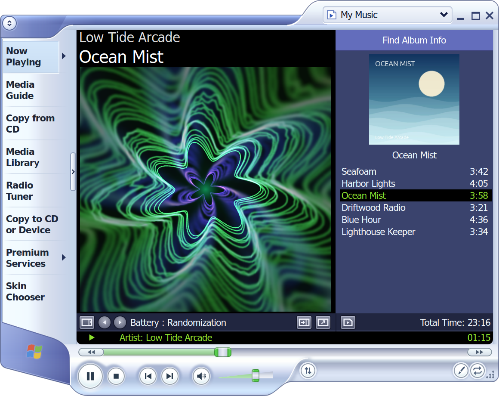
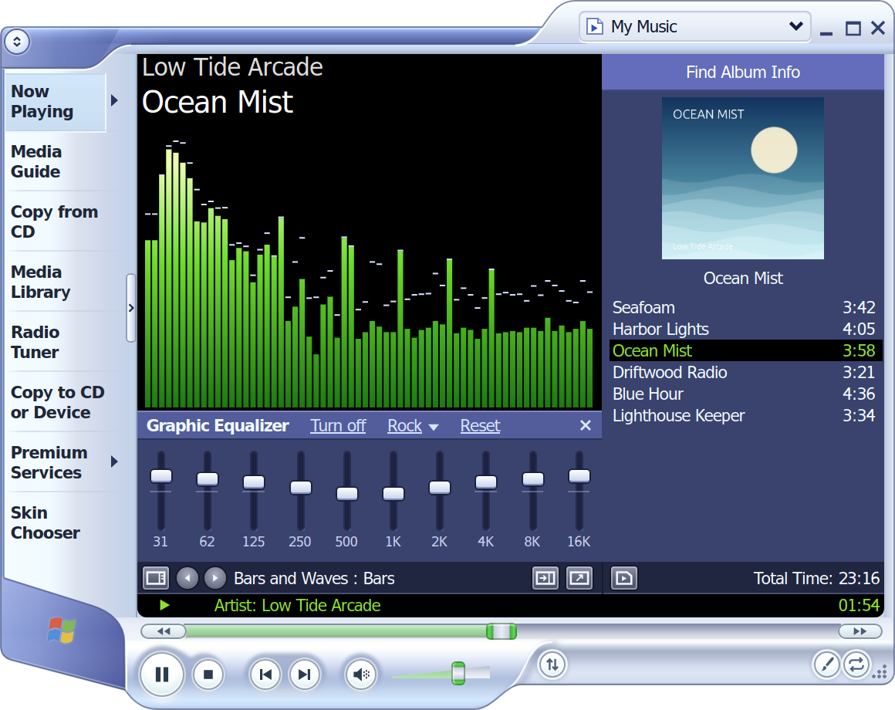
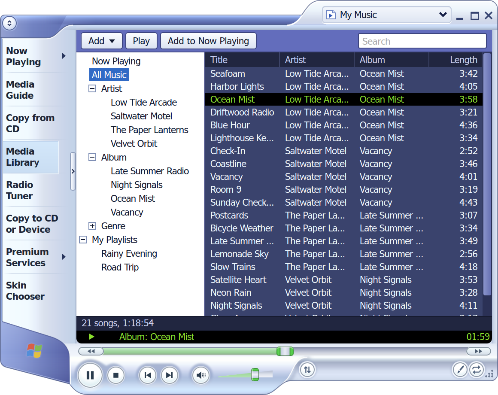
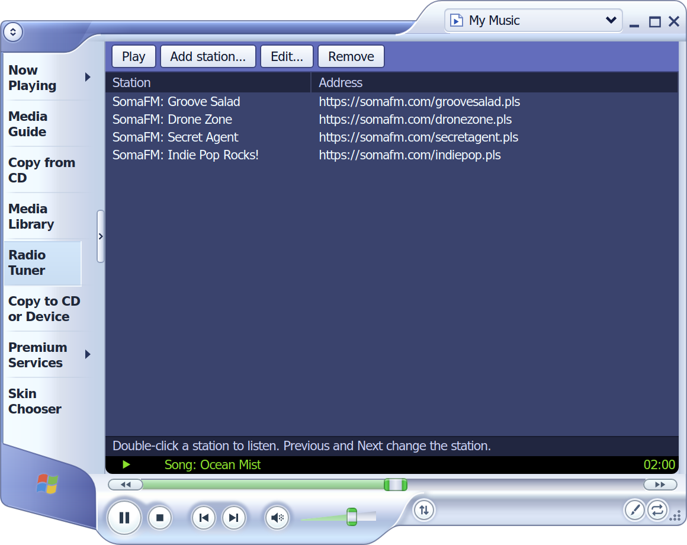
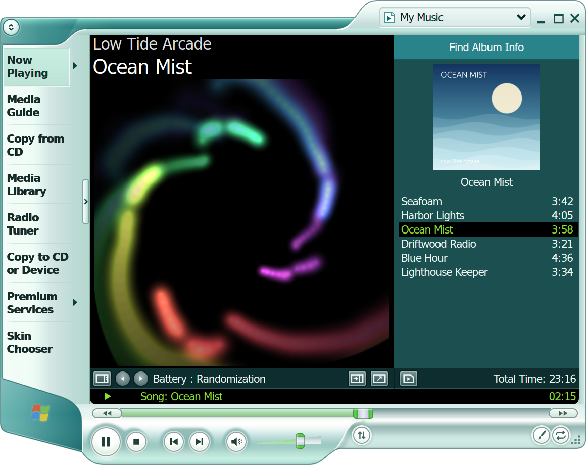
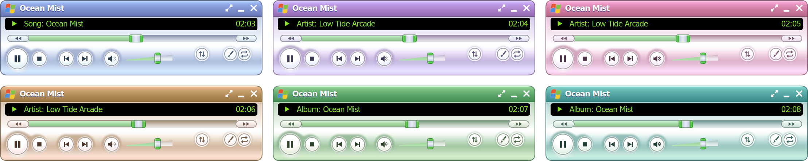
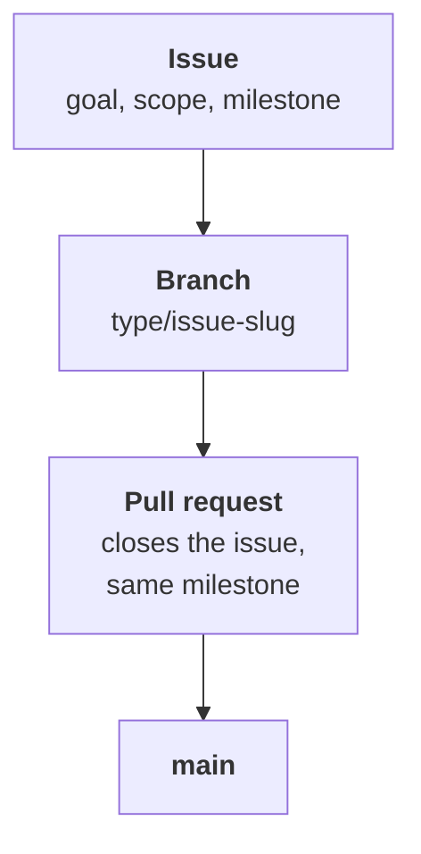

<div align="center">
  
  <h1>Ocean Mist</h1>
  <p><strong>The media player of the early 2000s, playing your music on Linux today.</strong></p>
  <p>
    A tribute to the look of Windows Media Player 9, drawn again from scratch:<br>
    the sculpted frame, the green status line, and visualizations you can watch for a whole album.
  </p>
  <p>
    
    
    
    
    <a href="LICENSE"></a>
  </p>
  <p>
    <a href="#a-look-around">A look around</a> &nbsp;·&nbsp;
    <a href="#what-it-does">What it does</a> &nbsp;·&nbsp;
    <a href="#get-started">Get started</a> &nbsp;·&nbsp;
    <a href="#keyboard">Keyboard</a> &nbsp;·&nbsp;
    <a href="#how-it-works">How it works</a> &nbsp;·&nbsp;
    <a href="#roadmap">Roadmap</a>
  </p>
</div>

<p align="center">
  
</p>

<p align="center">
  <sub>Every picture on this page is the player itself. The music in them is generated sample audio with invented names.</sub>
</p>

> [!NOTE]
> Ocean Mist is an unofficial fan project. It is not affiliated with, endorsed by or connected to Microsoft. Windows, Windows Media and the Windows logo are trademarks of Microsoft.

## A look around

### Visualizations that move with the music

<table>
  <tr>
    <td width="25%"></td>
    <td width="25%"></td>
    <td width="25%"></td>
    <td width="25%"></td>
  </tr>
  <tr>
    <td align="center"><sub>Battery : Kaleidovision</sub></td>
    <td align="center"><sub>Battery : Event Horizon</sub></td>
    <td align="center"><sub>Bars and Waves : Bars</sub></td>
    <td align="center"><sub>Ambience : Water</sub></td>
  </tr>
</table>

### The rest of the player

<table>
  <tr>
    <td width="50%"></td>
    <td width="50%"></td>
  </tr>
  <tr>
    <td valign="top"><strong>Graphic equalizer.</strong> Ten bands, eleven presets, and it remembers your own curve.</td>
    <td valign="top"><strong>Media Library.</strong> Your music folder by artist, album or genre, with search, sorting and your saved playlists.</td>
  </tr>
  <tr>
    <td></td>
    <td></td>
  </tr>
  <tr>
    <td valign="top"><strong>Radio Tuner.</strong> Internet radio stations, with the song title in the status line when the station sends it.</td>
    <td valign="top"><strong>Your color.</strong> The original blue, or purple, pink, red, orange, green or teal.</td>
  </tr>
</table>

### Compact mode

When the music matters more than the window, the player shrinks to a small bar that stays out of the way.

<p align="center">
  
</p>

## What it does

<table>
  <tr>
    <td width="170" valign="top"><strong>Visualizations</strong></td>
    <td>Eight of them: Battery (Randomization, Kaleidovision, Spider's Last Moment, Event Horizon, Sepiaswirl), Bars and Waves (Bars, Scope) and Ambience (Water). Or show the album cover instead.</td>
  </tr>
  <tr>
    <td width="170" valign="top"><strong>Graphic equalizer</strong></td>
    <td>10 bands from 31 Hz to 16 kHz, ±12 dB each, with 11 presets such as Rock, Jazz and Bass boost.</td>
  </tr>
  <tr>
    <td width="170" valign="top"><strong>Media Library</strong></td>
    <td>Reads your Music folder, and any other folder you add. Browse by artist, album or genre, search as you type, sort by any column. The files stay where they are.</td>
  </tr>
  <tr>
    <td width="170" valign="top"><strong>Now Playing list</strong></td>
    <td>Two lists, one player: My Music for your files and a second list for what you play from Premium Services, which takes its name from the service its songs come from (YouTube Music, Apple Music, Spotify, or a mix), kept apart and switched at the list's top right. Drag songs to reorder them, queue a song to play next, shuffle, repeat the list or a single song. Open a song from your file manager and its folder comes along as My Music.</td>
  </tr>
  <tr>
    <td width="170" valign="top"><strong>Playlists</strong></td>
    <td>Opens and saves <code>.m3u</code>; also reads <code>.m3u8</code> and <code>.pls</code>.</td>
  </tr>
  <tr>
    <td width="170" valign="top"><strong>Radio Tuner</strong></td>
    <td>Plays internet radio stations from a stream address or a <code>.pls</code> / <code>.m3u</code> link, and shows the song title when the station sends one. Add your own stations by address.</td>
  </tr>
  <tr>
    <td width="170" valign="top"><strong>YouTube Music</strong></td>
    <td>In Premium Services: search for songs, albums, artists and playlists, open them with their covers, and play them in a YouTube Music list of their own, with the equalizer and the visualizations. When the list runs out, similar songs carry on (<em>Autoplay similar songs</em> in the menu turns that off). The list lives in memory only and starts empty each time; save it as a playlist to keep it. Nothing else to install, and no account needed: sign in through Firefox to bring in your playlists and Liked music, like songs and add them to your playlists (see <em>Signing in to YouTube Music</em> below).</td>
  </tr>
  <tr>
    <td width="170" valign="top"><strong>Apple Music</strong></td>
    <td>In Premium Services: sign in through Firefox and browse your Apple Music library the way the website shows it: Recently added, Playlists, Albums, Artists and Songs, with covers; albums, playlists and artists open as pages, and long lists load a page at a time. Play puts the songs in the second Now Playing list; on a row of Recently added it puts the whole feed there, in the order shown, starting at the row you chose. Apple's own audio is protected, so the songs play in Apple's own web player, which Ocean Mist runs without a window in a <em>playback engine</em> that you download once, after a licence screen, and that runs only while a song of a service plays. It needs an active Apple Music subscription, which the engine checks, and the equalizer and the visualizations cannot work on Apple's songs. Nothing is changed in your account, and nothing of Apple's is kept on disk (see <em>Signing in to Apple Music</em> below).</td>
  </tr>
  <tr>
    <td width="170" valign="top"><strong>Spotify</strong></td>
    <td>In Premium Services: sign in through Firefox and browse your Spotify library the way the web player shows it: Liked Songs, Playlists, Albums and Artists, with covers; albums, playlists and artists open as pages, and long lists load a page at a time. Play puts the songs in the second Now Playing list. Spotify's own audio is protected, so the songs play in Spotify's own web player, which the same <em>playback engine</em> as Apple Music runs without a window, only while a song of a service plays. It needs an active Spotify Premium subscription, which the engine checks, and the equalizer and the visualizations cannot work on Spotify's songs. Nothing is changed in your account, and nothing of Spotify's is kept on disk (see <em>Signing in to Spotify</em> below).</td>
  </tr>
  <tr>
    <td width="170" valign="top"><strong>Formats</strong></td>
    <td>MP3, FLAC, Ogg Vorbis, Opus, M4A/AAC and WAV. Titles, covers and lengths are read by the player itself.</td>
  </tr>
  <tr>
    <td width="170" valign="top"><strong>Desktop integration</strong></td>
    <td>Implements MPRIS, the interface behind your keyboard's media keys and the desktop's media controls. Optional notification when the song changes.</td>
  </tr>
  <tr>
    <td width="170" valign="top"><strong>Sizes</strong></td>
    <td>Compact mode, full screen, and five player sizes from 100% to 200% for high-resolution screens.</td>
  </tr>
  <tr>
    <td width="170" valign="top"><strong>Small comforts</strong></td>
    <td>Picks up where you left off in your files or on the radio. A sleep timer stops the music after a set time or at the end of the song.</td>
  </tr>
</table>

> [!NOTE]
> YouTube Music, Apple Music and Spotify support is unofficial. Ocean Mist is not affiliated with or endorsed by Google, YouTube, Apple or Spotify, and it talks to YouTube Music, and to Apple Music's and Spotify's own web players, the way their websites do rather than through a published API, so a change on their side can break it until the player is updated. Their terms of service apply to what you play. YouTube and YouTube Music are trademarks of Google LLC. Apple and Apple Music are trademarks of Apple Inc. Spotify is a trademark of Spotify AB.

## Get started

Ocean Mist has no build step and nothing to compile: it is a handful of Python files and a web page. On Ubuntu 24.04 or later and Debian 13 or later you can install it as a package; on any distribution you can run it from a copy of the repository.

### As a package (Ubuntu 24.04 or later, Debian 13 or later)

Download `ocean-mist_0.1.0_all.deb` from the [latest release](https://github.com/NahuelGenchi/ocean-mist/releases/latest) (its SHA-256 is in the release notes). Open that file with your software installer, or install it from a terminal in the folder you saved it to (apt brings the libraries Ocean Mist needs):

```sh
sudo apt install ./ocean-mist_0.1.0_all.deb
```

To install a newer commit than the release, build the package from a copy of the repository instead. That needs `git` (`sudo apt install git` if you do not have it) and `dpkg-deb` (every Debian-based system has it), and no administrator rights:

```sh
git clone https://github.com/NahuelGenchi/ocean-mist.git
cd ocean-mist
packaging/build-deb.sh
sudo apt install ./dist/ocean-mist_*.deb
```

`packaging/build-deb.sh` writes `dist/ocean-mist_<version>_all.deb` from the last commit (what you have not committed does not go in). A build of a commit after a release is a snapshot, named after the next release with `~git` and the commit (for example `0.2.0~git20261017120000.abc1234`), so it installs over the release, and the next release installs over it.

Ocean Mist then appears in the app menu and in the "Open with" list for music files, and `ocean-mist` starts it from a terminal. The program lives in `/usr/lib/ocean-mist`, which only the administrator can change; your settings and the playback engine stay in your own folders (see "Where it keeps things" below). The package also installs one AppArmor profile, `/etc/apparmor.d/ocean-mist-engine`, which is what lets Apple Music's playback engine start on Ubuntu 24.04 and later without asking for your password (see "Signing in to Apple Music" below). That profile needs AppArmor 4.0 or later, so the package depends on it, and apt (and `dpkg -i`) refuse to install it on a system with an older one (Debian 12 has 3.0): run Ocean Mist from a copy of the repository there. It has been built and checked on Ubuntu 26.04 only; on the other releases it relies on what its dependencies say.

If you added a menu entry by hand earlier (step 3 of the other route), delete `~/.local/share/applications/io.github.nahuelgenchi.OceanMist.desktop`: an entry in your own folder wins over the package's and keeps starting the copy it points to.

`sudo apt remove ocean-mist` removes the program and keeps your settings and the engine you downloaded. The profile stops applying at once, but its file stays in `/etc/apparmor.d` until you purge the package, as apt does with every configuration file (until then AppArmor loads it again the next time it restarts or the computer starts): `sudo apt purge ocean-mist` removes it too (if AppArmor restarted between the removal and the purge, the loaded profile stays until the next restart).

### From a copy of the repository (any distribution)

**1. Install what it needs.** On Ubuntu or Debian:

```sh
sudo apt install python3-gi gir1.2-gtk-3.0 gir1.2-webkit2-4.1 \
  gstreamer1.0-plugins-good gstreamer1.0-plugins-bad gstreamer1.0-libav
```

On other distributions, install the equivalents: Python 3 with PyGObject, GTK 3, WebKitGTK with the 4.1 API, and the GStreamer plugins for the formats you listen to.

**2. Get it and run it.**

```sh
git clone https://github.com/NahuelGenchi/ocean-mist.git
cd ocean-mist
python3 player.py
```

Give it a song, a folder or a playlist to start playing right away:

```sh
python3 player.py ~/Music/album/song.flac
```

**3. Add it to your app menu** (optional). Run this from inside the `ocean-mist` folder:

```sh
mkdir -p ~/.local/share/applications
sed "s|@OCEAN_MIST_DIR@|$PWD|" data/io.github.nahuelgenchi.OceanMist.desktop.in \
  > ~/.local/share/applications/io.github.nahuelgenchi.OceanMist.desktop
install -Dm644 data/io.github.nahuelgenchi.OceanMist.svg \
  ~/.local/share/icons/hicolor/scalable/apps/io.github.nahuelgenchi.OceanMist.svg
```

After that, Ocean Mist appears in the app menu and in the "Open with" list for music files.

<details>
<summary><strong>Where it keeps things</strong></summary>

<br>

| What | Where |
| :--- | :--- |
| Settings, My Music, stations, where you left off | `~/.config/ocean-mist/state.json` |
| Tag cache and your files' covers | `~/.cache/ocean-mist/` |
| The playback engine, if you install it (Apple Music and Spotify) | `~/.local/share/ocean-mist/engine/` |
| The program, if you installed the package | `/usr/lib/ocean-mist/`, and the engine's permission in `/etc/apparmor.d/ocean-mist-engine` |

Nothing from YouTube Music, Apple Music or Spotify is kept in those folders, or anywhere else on disk unless you save a playlist: the list, searches and covers stay in memory, and so do your libraries when you sign in. The pages keep no web cache or site data. The covers they hand to the desktop's media controls wait in the runtime folder (`$XDG_RUNTIME_DIR`, which lives in memory) until the player closes, and so does a small folder of rules that keeps the services' pages from signing you out. Of a sign-in, `state.json` only notes which Firefox profile you chose for each service. The engine's folder holds the runtime you downloaded and what Chromium and Google's Widevine module keep for it, never your sign-in or your library; the engine's page in Premium Services removes all of it.

Your music files are only ever read, never changed. Developed on Ubuntu 26.04 with GNOME on Wayland and Python 3.14; other setups have not been tried yet.

</details>

<details>
<summary><strong>Signing in to YouTube Music</strong></summary>

<br>

Ocean Mist has no sign-in form of its own and never sees your password. You sign in to YouTube Music in Firefox, on Google's own page, and Ocean Mist uses that sign-in:

1. In Premium Services, choose **Library**, then **Sign in with Firefox**.
2. If Firefox is signed in to YouTube already, that is all. If not, Firefox opens on YouTube Music's sign-in page: sign in there, and Ocean Mist carries on by itself.
3. If more than one of your Firefox profiles is signed in to YouTube, choose the one Ocean Mist should use. They are listed by the names Firefox's profile menu shows, and Ocean Mist keeps to the one you chose.

Your playlists and Liked music then show under Library, and play like any playlist. Right-click a song to like it, to take the like back or to add it to one of your playlists. In a playlist of your own, you can also take a song out.

What Ocean Mist reads, and when:

- It reads the sign-in only while you are signed in (or signing in), and only when it asks for something of your account: your library, a playlist of yours, a like, a change to a playlist.
- It reads it from the cookie file of the Firefox profile you chose, read-only and straight into memory: no copy goes to disk, and the file is never written to. It takes only the YouTube cookies, not those of containers, and lets them go once the request is made. While you sign in, it reads every profile's cookie file this way, to see which ones are signed in. It also reads the profiles' names, to tell them apart.
- It never asks Google for your name, email address or photo. Your library, likes and playlists stay in memory, like the YouTube Music list. The only thing remembered is which Firefox profile you chose.
- Searches, albums, artists, similar songs and the music itself are still asked for anonymously, so they do not show in your YouTube history.

**Sign out**, at the top of Library, only stops Ocean Mist from using the sign-in: Firefox stays signed in. To sign out of YouTube itself, do it in Firefox. If you sign out there, or clear Firefox's cookies, Ocean Mist is signed out too.

Ocean Mist looks for your Firefox profiles where Firefox from Mozilla or from your distribution, the Snap and the Flatpak keep them, and signing in needs Python 3.11 or newer. Other browsers are not supported. If several Google accounts are signed in at once in that profile, the first one is used.

> [!CAUTION]
> These are YouTube Music's own web requests, not a published API, and signed in they are tied to your account. YouTube could sign the session out, or restrict the account. Ocean Mist makes them only for what you ask, at a person's pace.

</details>

<details>
<summary><strong>Signing in to Apple Music</strong></summary>

<br>

Apple lets only developers who pay Apple use its music API, and Ocean Mist asks for no such account. It does what a browser tab does instead, and the sign-in is again Firefox's, on Apple's own page: Ocean Mist has no sign-in form of its own and never sees your password.

1. In Premium Services, open **Apple Music** and choose **Sign in…**, then **Sign in with Firefox**.
2. If Firefox is signed in to Apple Music at music.apple.com already, that is all. If not, Firefox opens on Apple's page: sign in there, and Ocean Mist carries on by itself.
3. If more than one of your Firefox profiles is signed in, choose the one Ocean Mist should use. Ocean Mist keeps to the one you chose.

Recently added, Playlists, Albums, Artists and Songs then show under Apple Music in the order Apple gives them. Albums, playlists and artists open as pages, with their covers, and the long lists (Songs, mostly) load a page at a time as you scroll or press **Show more**.

**How a song plays.** Apple's own audio is protected by DRM, which Ocean Mist does not unlock or capture: Apple's own web player plays it, as it does in a browser tab, and Google's Widevine module decrypts it inside Chromium. The player has no such thing of its own, so Apple Music songs need a **playback engine**, which you download once from **Apple Music, Playback engine** in Premium Services. A licence screen comes first: it says what is downloaded (castlabs's build of Electron, 117 MB, from its GitHub releases, checked against the checksum Ocean Mist was made with; the first time it starts it also gets Google's Widevine module, about 45 MB, from Google), where it goes (`~/.local/share/ocean-mist/engine`, about 330 MB) and which licences come with it. Nothing is downloaded before you accept, and **Remove** deletes all of it.

When you play an Apple song, Ocean Mist starts the engine, which opens Apple's web player with no window (so no window or taskbar entry of its own appears) and plays the song there; Ocean Mist's own controls drive it: pause, seek, volume, next and previous, repeat, the sleep timer and the desktop's media keys. The engine ends a minute after the music stops (ten minutes after a pause) and when Ocean Mist closes. It needs an Apple Music account with an active subscription, which it checks each time it starts. Apple limits how many devices stream at once (one, on an individual plan), so a song started here can stop one playing on another device, and the other way round. There is a gap of a few seconds between songs, because each one is loaded when its turn comes. Firefox does not have to stay open: Ocean Mist reads the sign-in from Firefox's cookie file, which is still there when Firefox is closed.

Because the sound never passes through the player, **the equalizer and the visualizations cannot work on Apple songs**: the equalizer shows as off, and the visualization keeps moving on its own and says that it is not in time with the music. Songs from your files and from YouTube Music are not affected.

On Ubuntu 24.04 and later the engine needs a permission for its security sandbox: Chromium keeps Apple's page in a sandbox that needs user namespaces, and Ubuntu gives those only to programs that AppArmor has a profile for.

**With the package, that is already done.** It installs a profile, `/etc/apparmor.d/ocean-mist-engine` (short, so read it if you like), that names one file, `electron/electron` in `~/.local/share/ocean-mist/engine`, for every user whose home folder is under `/home` and for root, and gives it one permission: creating user namespaces. The engine then starts without asking for anything, and the screen before its download mentions no step. What that permission means: the file is in a folder its user can write, so a program that anything running as that user puts at that path gets the same permission (the profile Ubuntu ships for Chrome has no such reach, because only the administrator can write Chrome's file; Discord's own package installs a profile of the kind this one is, for its copy in the home folder). It gets that one permission and nothing else. `sudo aa-disable ocean-mist-engine` switches it off (an upgrade of the package leaves it off), and the engine's page then asks for the step itself; your own lines go in `/etc/apparmor.d/local/ocean-mist-engine`. A home folder outside `/home` is covered once AppArmor is told about it (`@{HOMEDIRS}+=/path/` in `/etc/apparmor.d/tunables/home.d/site.local`, then reload AppArmor).

**Where the package's profile does not name the engine's file** (there is no package, the data folder was moved elsewhere by `XDG_DATA_HOME`, the home folder is a symbolic link or sits deeper than `/home/<name>`, or the profile was switched off), it is **one step with administrator rights, once**. The engine's page has an **Allow it** button: your system asks for your password in its own window, the same one it shows for any change to the system (it is polkit's `pkexec`, so Ocean Mist never sees the password), and `engine/allow-sandbox.sh` then adds one AppArmor profile that names only the engine's file and gives it that one permission (read the script first if you like; the password window names it, and it runs from Ocean Mist's own folder). The sandbox is checked straight afterwards and nothing else is needed. The page has a button that takes the profile away again, which asks for your password again. That profile belongs to the administrator: removing the engine leaves it, and the page keeps offering to take it away for as long as it is on the system. Where the system has no password window, or it did not work, the page shows the same step as a command to run in a terminal, and the one that undoes it. The engine never runs without its sandbox.

What Ocean Mist reads, and when:

- It reads the sign-in only while you are signed in (or signing in): the one cookie Apple's web player signs in with, from the cookie file of the Firefox profile you chose, read-only and straight into memory. No copy goes to disk, and the file is never written to. While you sign in, it reads every profile's cookie file this way, to see which ones are signed in, and the profiles' names, to tell them apart. Only the cookies of the normal browsing window count, not those of containers or private windows.
- It hands that cookie to a view of music.apple.com that has no window: Apple's web player, starting up as it does in any browser tab. The view keeps everything in memory (no cache, no site data) and closes after ten minutes without a request. The playback engine gets the same cookie on its standard input, never on a command line or in its environment, keeps it in an in-memory session, and keeps to Apple's own addresses over https: it refuses to go to any other site, by a link, a redirect or a frame.
- It asks the page for your library with read-only requests, and never itself for your name, email address or photo. **Nothing in your Apple Music account is changed**, and Ocean Mist has no way to change it: it does not add, remove, rate or reorder anything. Before the page loads, every request that would sign you out is blocked, because a sign-out there would end the one in Firefox too; if that block cannot be put in place, the page is not opened.
- Playing an Apple song asks Apple's page to play it, as the website does, and nothing else: Ocean Mist adds nothing to your library or your play history on purpose (Apple's page may record that you played the song, as it does when you play it in a browser).

**Sign out**, at the top of any Apple Music list, only stops Ocean Mist from using the sign-in: Firefox stays signed in. To sign out of Apple Music itself, do it in Firefox. If you sign out there, or clear Firefox's cookies, Ocean Mist is signed out too.

Ocean Mist looks for your Firefox profiles in the same places as for YouTube Music, and Firefox is the only browser it can read. Whether a song plays depends on your subscription and on Apple having it for your account.

> [!CAUTION]
> These are Apple's own web-player requests, not a published API, and signed in they are tied to your account. Apple could change the page, sign the session out, or restrict the account. Ocean Mist makes them only for what you ask, at a person's pace, and reads only.

</details>

<details>
<summary><strong>Signing in to Spotify</strong></summary>

<br>

Spotify's Web API needs a client id and a sign-in flow of its own, which Ocean Mist does not keep. It does what a browser tab does instead, and the sign-in is again Firefox's, on Spotify's own page: Ocean Mist has no sign-in form of its own and never sees your password.

1. In Premium Services, open **Spotify** and choose **Sign in…**, then **Sign in with Firefox**.
2. If Firefox is signed in to Spotify at open.spotify.com already, that is all. If not, Firefox opens on Spotify's page: sign in there, and Ocean Mist carries on by itself.
3. If more than one of your Firefox profiles is signed in, choose the one Ocean Mist should use. Ocean Mist keeps to the one you chose.

Liked Songs, Playlists, Albums and Artists then show under Spotify in the order Spotify gives them. Albums, playlists and artists open as pages, with their covers, and the long lists (Liked Songs, mostly) load a page at a time as you scroll or press **Show more**.

**How a song plays.** Spotify's own audio is protected by DRM, which Ocean Mist does not unlock or capture: Spotify's own web player plays it, as it does in a browser tab, and Google's Widevine module decrypts it inside Chromium. Spotify's songs use the same **playback engine** as Apple Music's, downloaded once (see *Signing in to Apple Music* above for what it is, where it goes and the one-time sandbox step on Ubuntu 24.04 and later).

When you play a Spotify song, Ocean Mist starts the engine, which opens Spotify's web player with no window and plays the song there; Ocean Mist's own controls drive it: pause, seek, volume, next and previous, repeat, the sleep timer and the desktop's media keys. The engine ends a minute after the music stops (ten minutes after a pause) and when Ocean Mist closes. It needs a Spotify account with an active Premium subscription, which the engine checks when it starts; without one, or when Spotify's page does not say the plan in time, the songs do not play. Spotify plays one stream per account, so a song started here can stop one playing on another device, and the other way round. There is a gap of a few seconds between songs, because each one is loaded when its turn comes. Firefox does not have to stay open: Ocean Mist reads the sign-in from Firefox's cookie file, which is still there when Firefox is closed.

Because the sound never passes through the player, **the equalizer and the visualizations cannot work on Spotify songs**, as on Apple Music's.

What Ocean Mist reads, and when:

- It reads the sign-in only while you are signed in (or signing in): the cookies Spotify's web player signs in with (`sp_dc` and the ones that come along), from the cookie file of the Firefox profile you chose, read-only and straight into memory. No copy goes to disk, and the file is never written to. While you sign in, it reads every profile's cookie file this way, to see which ones are signed in, and the profiles' names, to tell them apart. Only the cookies of the normal browsing window count, not those of containers or private windows.
- It hands them to a view of open.spotify.com that has no window: Spotify's web player, starting up as it does in any browser tab. The view keeps everything in memory (no cache, no site data) and closes after ten minutes without a request. Its requests are the page's own, kept in memory so a page of your library can be asked for again with a different offset. The playback engine gets the same cookies on its standard input, never on a command line or in its environment, keeps them in an in-memory session, and keeps to Spotify's own addresses over https: it refuses to go to any other site, by a link, a redirect or a frame.
- It asks the page for your library with read-only requests, and never itself for your name, email address or photo. **Nothing in your Spotify account is changed**, and Ocean Mist has no way to change it: it does not add, remove, like or reorder anything. Before the page loads, every request that would sign you out is blocked, because a sign-out there would end the one in Firefox too; if that block cannot be put in place, the page is not opened.
- Playing a Spotify song asks Spotify's page to play it, as the website does, and nothing else: Ocean Mist adds nothing to your library or your play history on purpose (Spotify's page may record that you played the song, as it does when you play it in a browser).

**Sign out**, at the top of any Spotify list, only stops Ocean Mist from using the sign-in: Firefox stays signed in. To sign out of Spotify itself, do it in Firefox. If you sign out there, or clear Firefox's cookies, Ocean Mist is signed out too.

Ocean Mist looks for your Firefox profiles in the same places as for YouTube Music, and Firefox is the only browser it can read. Whether a song plays depends on your subscription and on Spotify having it for your account.

> [!CAUTION]
> These are Spotify's own web-player requests, not a published API, and signed in they are tied to your account. Spotify's User Guidelines do not allow reaching the service by automated means, so Spotify could change the page, sign the session out, or restrict the account. Ocean Mist makes them only for what you ask, at a person's pace, and reads only.

</details>

## Keyboard

| Keys | Action |
| :--- | :--- |
| <kbd>Space</kbd> or <kbd>Ctrl</kbd>+<kbd>P</kbd> | Play or pause |
| <kbd>Ctrl</kbd>+<kbd>S</kbd> | Stop |
| <kbd>Ctrl</kbd>+<kbd>B</kbd> / <kbd>Ctrl</kbd>+<kbd>F</kbd> | Previous / next song |
| <kbd>←</kbd> / <kbd>→</kbd> | Back / forward 5 seconds |
| <kbd>↑</kbd> / <kbd>↓</kbd> | Volume up / down |
| <kbd>Ctrl</kbd>+<kbd>H</kbd> | Shuffle on or off |
| <kbd>Ctrl</kbd>+<kbd>T</kbd> | Repeat: off, list, song |
| <kbd>Ctrl</kbd>+<kbd>O</kbd> | Open files |
| <kbd>Ctrl</kbd>+<kbd>2</kbd> / <kbd>Ctrl</kbd>+<kbd>1</kbd> | Compact mode / back to the full player |
| <kbd>F11</kbd> or <kbd>Alt</kbd>+<kbd>Enter</kbd> | Full screen (<kbd>Esc</kbd> leaves it) |
| <kbd>Enter</kbd> / <kbd>Delete</kbd> | Play / remove the selected song in the list |

The keyboard's media keys reach the player through the desktop's media controls (MPRIS).

## How it works

The window has no title bar and no borders of its own: it is a transparent, frameless GTK window showing a local web page, and the page draws the whole player: the frame in SVG, the visualizations on a canvas. `player.py` owns the window and runs a small server on `127.0.0.1` that hands the page its files, your songs, the radio streams, YouTube Music, Apple Music and Spotify. Nothing is served outside your computer. The only network traffic is the radio station you tune to, and what you search for, play and, signed in, open or change in Premium Services.

YouTube Music has no public API for a player like this one, so `ytmusic.py` makes the same requests the YouTube Music apps make: searches, albums, artists, playlists and similar songs, then each song's audio. That audio arrives as AAC in pieces a few seconds long; `ytmusic.py` repacks each piece as MP4 and the page plays them through Media Source, so no YouTube code, player or app runs. When you have signed in, the requests for your library and its changes carry the sign-in that `firefox.py` reads from Firefox, signed the way the website signs its own; all the others stay anonymous.

Apple Music has no public API for a program like this one either, and its audio is protected, so `apple.py` takes a different road: it opens music.apple.com, Apple's web player, in a view of its own that has no window, signed in with the one cookie `firefox.py` reads from Firefox, and asks the page's own MusicKit for your library. The view blocks every request that would sign you out, changes nothing in your account and closes when it is not used. The songs are another matter: Apple's audio is protected, so `engine.py` plays them in a playback engine, a copy of Chromium with Google's Widevine module (castlabs's build of Electron, downloaded once with your consent) that runs `engine/helper/main.js`. The helper opens Apple's web player in a window that is never shown, signed in with the same cookie, and the page drives it through `engine.py`: play, pause, seek, volume, and a report of where the song is.

Spotify has no public API for a program like this one either, and its audio is protected, so `spotify.py` takes the same road as `apple.py`: it opens open.spotify.com, Spotify's web player, in a view of its own that has no window, signed in with the cookies `firefox.py` reads from Firefox, keeps the page's own requests in memory and asks them again for each page of your Liked Songs, playlists, albums and artists. The view blocks every request that would sign you out, changes nothing in your account and closes when it is not used. The songs play in the same playback engine: the helper opens Spotify's web player in a window that is never shown, signed in with the same cookies, and the page drives it through `engine.py` the same way.

```mermaid
flowchart LR
    subgraph window["Frameless, transparent GTK window"]
        page["<b>ui/</b><br/>frame, controls,<br/>visualizations, equalizer"]
    end
    host["<b>player.py</b><br/>window, dialogs,<br/>local server"]
    radio["<b>radio.py</b><br/>station relay"]
    library["<b>library.py</b><br/>lists, library, settings"]
    tags["<b>tags.py</b><br/>titles, covers, lengths"]
    ytmusic["<b>ytmusic.py</b><br/>YouTube Music"]
    apple["<b>apple.py</b><br/>Apple Music"]
    spotify["<b>spotify.py</b><br/>Spotify"]
    engine["<b>engine.py</b><br/>playback engine"]
    firefox["<b>firefox.py</b><br/>your sign-ins"]
    mpris["<b>mpris.py</b><br/>media keys"]
    page <-->|"HTTP on 127.0.0.1"| host
    host --> radio
    host --> library --> tags
    host --> ytmusic
    host --> apple
    host --> spotify
    host --> engine
    host --> firefox
    host --> mpris
```



| Path | What is in it |
| :--- | :--- |
| `player.py` | The host: window, input shape, local server, file dialogs, sizes, notifications |
| `library.py` | The two Now Playing lists (My Music is saved, YouTube Music, with the service songs in it, stays in memory), the library scan, playlists, stations, settings |
| `tags.py` | Tag, cover and length reader for six formats, standard library only |
| `radio.py` | Relays a station to the page and reads its song titles |
| `ytmusic.py` | YouTube Music: searches, albums, artists, playlists, similar songs and covers, and each song's audio repacked for the page; signed in, your library, likes and playlist changes. Standard library only |
| `apple.py` | Apple Music: your library, read through Apple's own web page in a windowless view |
| `spotify.py` | Spotify: your Liked Songs, playlists, albums and artists, read through Spotify's own web player in a windowless view |
| `engine.py`, `engine/` | The playback engine for Apple Music and Spotify songs: the download, its checks and the one-time sandbox step (`allow-sandbox.sh`), and the helper (`helper/main.js`) that plays the songs in a window that is never shown |
| `firefox.py` | Reads the YouTube, Apple Music and Spotify sign-ins of the Firefox profile you chose into memory when a request needs them, read-only, standard library only |
| `mpris.py` | The desktop's media controls |
| `ui/` | The page: `frame.js` draws the frame, `app.js` plays the music, `visuals.js` draws the visualizations, `premium.js` is Premium Services (YouTube Music, Apple Music and Spotify) |
| `data/` | Application icon and menu entry |
| `packaging/` | `build-deb.sh`, which builds the Debian package from the last commit, and the files that go into it: the control file, the maintainer scripts, the engine's AppArmor profile and the copyright notice |

## Roadmap

Ocean Mist is young. What is on this page works today; these parts of the original are not there:

- **Media Guide, Copy from CD and Copy to CD or Device** are in the task bar because the original had them, and open a short note instead.
- **Gapless playback** between songs is not built yet.
- **YouTube Music** signs in through Firefox only. Library albums, artists, songs and uploads are not there yet, playlists cannot be made or renamed, and live streams do not play.
- **Apple Music** is read-only. Its songs play in the playback engine, which is a 117 MB download and, on Ubuntu 24.04 and later, needs a permission for its sandbox (the package installs it; without the package it asks once, with administrator rights); the equalizer and the visualizations cannot work on them, there is a gap of a few seconds between songs, and Apple limits how many devices stream at once. It signs in through Firefox only, and searching all of Apple Music (beyond your library) is not there.
- **Spotify** is read-only, like Apple Music: Liked Songs, playlists, albums and artists from your library, no search of all of Spotify, and its songs need Spotify Premium; they play in the playback engine, with the same limits as Apple Music's (the download, the sandbox step, no equalizer or visualizations, a gap between songs), and Spotify plays one stream per account. It signs in through Firefox only. Other streaming services are not started.
- **Releases**: the Debian package is published with each release on GitHub (0.1.0 is the first) and checked on Ubuntu 26.04 only. There is no apt repository, Flatpak or Snap yet, so a newer release is installed the same way, by downloading its package.

| Milestone | Outcome |
| :--- | :--- |
| [M0 — Project foundation](https://github.com/NahuelGenchi/ocean-mist/milestone/1) | Repository, documentation and the way work is tracked |
| [M1 — Classic player](https://github.com/NahuelGenchi/ocean-mist/milestone/2) | The look and local listening: visualizations, equalizer, library, radio, playlists, and their fixes |
| [M2 — Streaming services](https://github.com/NahuelGenchi/ocean-mist/milestone/3) | Music from streaming services inside the player |
| [M3 — Release](https://github.com/NahuelGenchi/ocean-mist/milestone/4) | Packaging, installation and versioned releases |

## Contributing

Every change, however small, follows the same trail:



Found a bug or have an idea? [Open a work item](https://github.com/NahuelGenchi/ocean-mist/issues/new/choose). Before sending code, read [CONTRIBUTING.md](CONTRIBUTING.md) and [docs/TRACKING.md](docs/TRACKING.md); agents start with [AGENTS.md](AGENTS.md).

## Credits

- The look pays tribute to **Windows Media Player 9 Series** by Microsoft. The frame, buttons and visualizations here are redrawn in SVG and canvas; no code or image files from the original are included.
- The interface font is the **Tahoma replacement from the [Wine](https://www.winehq.org/) project**, under the LGPL 2.1 or later; its notices are in [`ui/fonts`](ui/fonts/README.md).
- The four stations that come preset are from **[SomaFM](https://somafm.com/)**, listener-supported radio.
- The Apple Music playback engine is **castlabs's [Electron for Content Security](https://github.com/castlabs/electron-releases)**, a build of [Electron](https://www.electronjs.org/) (MIT) and Chromium (BSD and other open-source licences, listed in `LICENSES.chromium.html` in the download) with support for Google's **Widevine** module, which Google licenses on its own terms. None of it is part of this repository: the player downloads it when you ask, from castlabs's releases and, for Widevine, from Google.

## License

Ocean Mist is free software: you can use, study, share and change it under the terms of the [GNU General Public License](LICENSE), version 3 or (at your option) any later version. If you share a changed version, its source goes with it, under the same license. It comes with no warranty.

The license covers Ocean Mist's own code and artwork (the playback engine's helper, `engine/helper/main.js`, included). It does not cover the bundled fonts, which keep [their own license](ui/fonts/README.md) (LGPL 2.1 or later), the playback engine you download (Electron, Chromium and Google's Widevine module, each under its own terms), or Microsoft's trademarks, including the Windows logo drawn in the frame.
