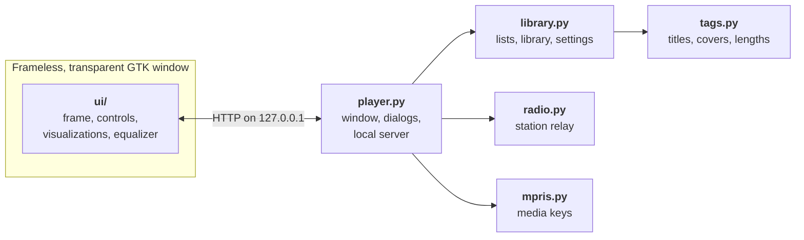
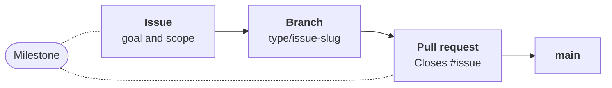

<div align="center">
  
  <h1>Ocean Mist</h1>
  <p><strong>The media player of the early 2000s, playing your music on Linux today.</strong></p>
  <p>
    A tribute to the look of Windows Media Player 9, drawn again from scratch:<br>
    the sculpted frame, the green status line, and visualizations you can watch for a whole album.
  </p>
  <p>
    
    
    
    
  </p>
  <p>
    <a href="#a-look-around">A look around</a> &nbsp;·&nbsp;
    <a href="#what-it-does">What it does</a> &nbsp;·&nbsp;
    <a href="#get-started">Get started</a> &nbsp;·&nbsp;
    <a href="#keyboard">Keyboard</a> &nbsp;·&nbsp;
    <a href="#how-it-works">How it works</a> &nbsp;·&nbsp;
    <a href="#roadmap">Roadmap</a>
  </p>
</div>

<p align="center">
  
</p>

<p align="center">
  <sub>Every picture on this page is the player itself. The music in them is generated sample audio with invented names.</sub>
</p>

> [!NOTE]
> Ocean Mist is an unofficial fan project. It is not affiliated with, endorsed by or connected to Microsoft. Windows and Windows Media are trademarks of Microsoft.

## A look around

### Visualizations that move with the music

<table>
  <tr>
    <td width="25%"></td>
    <td width="25%"></td>
    <td width="25%"></td>
    <td width="25%"></td>
  </tr>
  <tr>
    <td align="center"><sub>Battery : Kaleidovision</sub></td>
    <td align="center"><sub>Battery : Event Horizon</sub></td>
    <td align="center"><sub>Bars and Waves : Bars</sub></td>
    <td align="center"><sub>Ambience : Water</sub></td>
  </tr>
</table>

### The rest of the player

<table>
  <tr>
    <td width="50%"></td>
    <td width="50%"></td>
  </tr>
  <tr>
    <td valign="top"><strong>Graphic equalizer.</strong> Ten bands, eleven presets, and it remembers your own curve.</td>
    <td valign="top"><strong>Media Library.</strong> Your music folder by artist, album or genre, with search, sorting and your saved playlists.</td>
  </tr>
  <tr>
    <td></td>
    <td></td>
  </tr>
  <tr>
    <td valign="top"><strong>Radio Tuner.</strong> Internet radio stations, with the song title in the status line when the station sends it.</td>
    <td valign="top"><strong>Your color.</strong> The original blue, or purple, pink, red, orange, green or teal.</td>
  </tr>
</table>

### Compact mode

When the music matters more than the window, the player shrinks to a small bar that stays out of the way.

<p align="center">
  
</p>

## What it does

| | |
| :--- | :--- |
| **Visualizations** | Eight of them: Battery (Randomization, Kaleidovision, Spider's Last Moment, Event Horizon, Sepiaswirl), Bars and Waves (Bars, Scope) and Ambience (Water). Or show the album cover instead. |
| **Graphic equalizer** | 10 bands from 31 Hz to 16 kHz, ±12 dB each, with 11 presets such as Rock, Jazz and Bass boost. |
| **Media Library** | Reads your Music folder, and any other folder you add. Browse by artist, album or genre, search as you type, sort by any column. The files stay where they are. |
| **Now Playing list** | Drag songs to reorder them, queue a song to play next, shuffle, repeat the list or a single song. Open a song from your file manager and its folder comes along as the list. |
| **Playlists** | Opens and saves `.m3u`; also reads `.m3u8` and `.pls`. |
| **Radio Tuner** | Plays internet radio stations from a stream address or a `.pls` / `.m3u` link, and shows the song title when the station sends one. Add your own stations by address. |
| **Formats** | MP3, FLAC, Ogg Vorbis, Opus, M4A/AAC and WAV. Titles, covers and lengths are read by the player itself. |
| **Desktop integration** | Implements MPRIS, the interface behind your keyboard's media keys and the desktop's media controls. Optional notification when the song changes. |
| **Sizes** | Compact mode, full screen, and five player sizes from 100% to 200% for high-resolution screens. |
| **Small comforts** | Picks up where you left off. A sleep timer stops the music after a set time or at the end of the song. |

## Get started

Ocean Mist has no build step and nothing to compile: it is a handful of Python files and a web page.

**1. Install what it needs.** On Ubuntu or Debian:

```sh
sudo apt install python3-gi gir1.2-gtk-3.0 gir1.2-webkit2-4.1 \
  gstreamer1.0-plugins-good gstreamer1.0-plugins-bad gstreamer1.0-libav
```

On other distributions, install the equivalents: Python 3 with PyGObject, GTK 3, WebKitGTK with the 4.1 API, and the GStreamer plugins for the formats you listen to.

**2. Get it and run it.**

```sh
git clone https://github.com/NahuelGenchi/ocean-mist.git
cd ocean-mist
python3 player.py
```

Give it a song, a folder or a playlist to start playing right away:

```sh
python3 player.py ~/Music/album/song.flac
```

**3. Add it to your app menu** (optional). Run this from inside the `ocean-mist` folder:

```sh
mkdir -p ~/.local/share/applications
sed "s|@OCEAN_MIST_DIR@|$PWD|" data/io.github.nahuelgenchi.OceanMist.desktop.in \
  > ~/.local/share/applications/io.github.nahuelgenchi.OceanMist.desktop
install -Dm644 data/io.github.nahuelgenchi.OceanMist.svg \
  ~/.local/share/icons/hicolor/scalable/apps/io.github.nahuelgenchi.OceanMist.svg
```

After that, Ocean Mist appears in the app menu and in the "Open with" list for music files.

<details>
<summary><strong>Where it keeps things</strong></summary>

<br>

| What | Where |
| :--- | :--- |
| Settings, the current list, stations, where you left off | `~/.config/ocean-mist/state.json` |
| Tag cache and covers | `~/.cache/ocean-mist/` |

Your music files are only ever read, never changed. Developed on Ubuntu 26.04 with GNOME on Wayland and Python 3.14; other setups have not been tried yet.

</details>

## Keyboard

| Keys | Action |
| :--- | :--- |
| <kbd>Space</kbd> or <kbd>Ctrl</kbd>+<kbd>P</kbd> | Play or pause |
| <kbd>Ctrl</kbd>+<kbd>S</kbd> | Stop |
| <kbd>Ctrl</kbd>+<kbd>B</kbd> / <kbd>Ctrl</kbd>+<kbd>F</kbd> | Previous / next song |
| <kbd>←</kbd> / <kbd>→</kbd> | Back / forward 5 seconds |
| <kbd>↑</kbd> / <kbd>↓</kbd> | Volume up / down |
| <kbd>Ctrl</kbd>+<kbd>H</kbd> | Shuffle on or off |
| <kbd>Ctrl</kbd>+<kbd>T</kbd> | Repeat: off, list, song |
| <kbd>Ctrl</kbd>+<kbd>O</kbd> | Open files |
| <kbd>Ctrl</kbd>+<kbd>2</kbd> / <kbd>Ctrl</kbd>+<kbd>1</kbd> | Compact mode / back to the full player |
| <kbd>F11</kbd> or <kbd>Alt</kbd>+<kbd>Enter</kbd> | Full screen (<kbd>Esc</kbd> leaves it) |
| <kbd>Enter</kbd> / <kbd>Delete</kbd> | Play / remove the selected song in the list |

The keyboard's media keys reach the player through the desktop's media controls (MPRIS).

## How it works

The window has no title bar and no borders of its own: it is a transparent, frameless GTK window showing a local web page, and the page draws the whole player: the frame in SVG, the visualizations on a canvas. `player.py` owns the window and runs a small server on `127.0.0.1` that hands the page its files, your songs and the radio streams. Nothing is served outside your computer, and the only network traffic is the radio station you tune to.



| Path | What is in it |
| :--- | :--- |
| `player.py` | The host: window, input shape, local server, file dialogs, sizes, notifications |
| `library.py` | The Now Playing list, the library scan, playlists, stations, settings |
| `tags.py` | Tag, cover and length reader for six formats, standard library only |
| `radio.py` | Relays a station to the page and reads its song titles |
| `mpris.py` | The desktop's media controls |
| `ui/` | The page: `frame.js` draws the frame, `app.js` plays the music, `visuals.js` draws the visualizations |
| `data/` | Application icon and menu entry |

## Roadmap

Ocean Mist is young. What is on this page works today; these parts of the original are not there:

- **Media Guide, Copy from CD, Copy to CD or Device and Premium Services** are in the task bar because the original had them, and open a short note instead.
- **Gapless playback** between songs is not built yet.
- **Streaming services** are planned, not started.

| Milestone | Outcome |
| :--- | :--- |
| [M0 — Project foundation](https://github.com/NahuelGenchi/ocean-mist/milestone/1) | Repository, documentation and the way work is tracked |
| [M1 — Classic player](https://github.com/NahuelGenchi/ocean-mist/milestone/2) | The look and local listening: visualizations, equalizer, library, radio, playlists, and their fixes |
| [M2 — Streaming services](https://github.com/NahuelGenchi/ocean-mist/milestone/3) | Music from streaming services inside the player |
| [M3 — Release](https://github.com/NahuelGenchi/ocean-mist/milestone/4) | Packaging, installation and versioned releases |

## Contributing

Every change, however small, follows the same trail:



Found a bug or have an idea? [Open a work item](https://github.com/NahuelGenchi/ocean-mist/issues/new/choose). Before sending code, read [CONTRIBUTING.md](CONTRIBUTING.md) and [docs/TRACKING.md](docs/TRACKING.md); agents start with [AGENTS.md](AGENTS.md).

## Credits

- The look pays tribute to **Windows Media Player 9 Series** by Microsoft. The frame, buttons and visualizations here are redrawn in SVG and canvas; no code or image files from the original are included.
- The interface font is the **Tahoma replacement from the [Wine](https://www.winehq.org/) project**, under the LGPL 2.1.
- The four stations that come preset are from **[SomaFM](https://somafm.com/)**, listener-supported radio.

**License:** not chosen yet; see [#3](https://github.com/NahuelGenchi/ocean-mist/issues/3). Until it is, the code is published for reading and trying out, and the fonts keep their own license.
